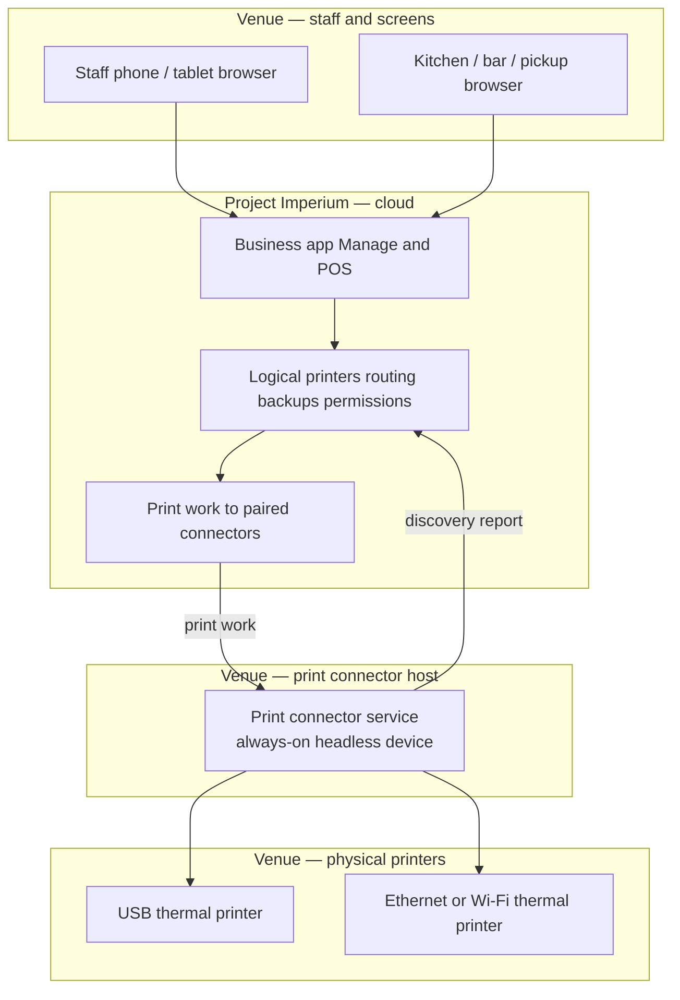
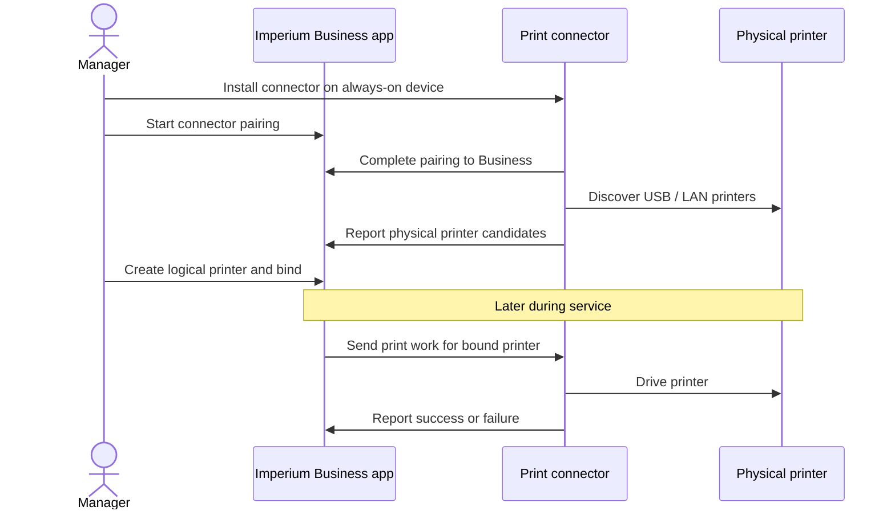

# ADR-0008: Cloud print path via venue print connector

- **Status:** Accepted (amended 2026-10-27; see Amendment 2 for the current host and kit)
- **Date:** 2026-10-21

## Context

Project Imperium is cloud SaaS. Venue receipt and prep printers are ordinary local
devices (USB, Ethernet, or Wi‑Fi on the venue LAN). The browser and the cloud
cannot reliably discover or drive those printers: there is no public router API,
browser sandboxes block LAN printing for kitchen/receipt workflows, and OS print
dialogs are the wrong protocol for ESC/POS-style tickets.

Venues also need a **minimum hardware kit**: phones and optional screens first,
paper and bridges only when the venue chooses them — without Imperium imposing
device counts or brands.

Product behaviour for logical printers, binding, routing, backups, and screens
lives in the printers-and-screens subject. This ADR records the architecture
decision behind that path.

## Decision

1. **Staff and control-screen devices talk only to Imperium (cloud).** They never
   open local printer addresses, read the venue router, or act as the primary
   print driver for multi-device service.
2. **Paper on ordinary local printers uses Imperium's print connector** — a small
   always-on helper the venue runs on a local **headless mini-PC or single-board
   computer**. Day-to-day the host is **headless infrastructure**, never a
   general-purpose staff desktop or a day-to-day workstation.
3. **Bring-up is install → pair → discover → bind in Imperium**, not a local-only
   setup script that configures printers outside the product:
   - Install the connector so it starts on boot.
   - Pair it to the Business (manager starts in Imperium; connector completes).
   - Connector discovers USB/LAN printers and reports candidates to Imperium.
   - Managers create logical printers and bind them in the Business app.
4. **Logical printer + binding** remains the product model: configuration and
   routing survive hardware swaps; rebinding points at another physical target.
5. **Own connector is the primary path.** Manufacturer cloud-print targets may
   appear as optional physical targets under the same binding model; they are
   not the only supported path.
6. **Minimum kit:** a connector is required only when the venue prints through
   that path. Prep paper and dedicated screens stay optional. Go-live does not
   require a receipt printer unless the business turns on **Printed receipts
   required**, which makes a receipt printer and a usable print path go-live
   gates.

## Architecture

## Consequences

**Positive**

- Matches how cloud restaurant POS products reach local printers.
- Keeps the SaaS product free of on-premise deployment while still supporting
  brand-agnostic hardware.
- Lets small venues start with phones + optional screens + one receipt printer
  and one connector (or screens-only prep), then add printers without redesign.

**Negative / trade-offs**

- Venues that want paper on classic LAN/USB printers must keep at least one
  always-on connector device during service.
- Connector health, offline detection, and backup failover become operational
  concerns (already committed in printers-and-screens).

**Follow-ups**

- Implement connector install (boot service), pairing to the Business, discovery
  reporting, job delivery, and success/failure reporting against the product
  commitments. Binding and routing stay in the Business app — not a standalone
  local configuration script.
- Optionally expose manufacturer cloud-print as a secondary physical-target type
  without changing logical-printer configuration.

## Amendment (2026-10-27) — connector identity, lifecycle, and reliability

The original decision established the bridge shape. This amendment tightens the
operational contract the product now commits to.

1. **Host is a headless mini-PC or single-board computer only.** A general-purpose
   desktop or staff workstation is not a supported host.
2. **Supported printers speak standard protocols** over USB or LAN — for example
   ESC/POS, Star Line Mode, ZPL, ePOS, and raw network/USB. Windows-driver-only
   printers and certified fiscal devices are out of scope for v1.
3. **Each connector owns its credential.** Pairing issues a per-connector,
   Business-scoped credential; connectors are listed in Manage and revocable in
   one click. Revocation ends trust immediately and re-pairing rotates the
   credential.
4. **Lifecycle baseline:** signed auto-updates on by default with staged rollout;
   version reporting; the cloud refuses work below a minimum supported version
   with an alert; run-on-boot; crash auto-restart; watchdog reboot; no exposed
   local API; outbound-only connections; unused USB ports disabled or allowlisted
   where the host permits.
5. **Health and fallback are observable.** The connector reports its active WAN
   path; connector-offline and cellular-fallback transitions alert managers on
   duty.
6. **Print work is reliable.** Jobs are durably queued server-side per logical
   printer, delivered idempotently after reconnect, with per-kind expiry: prep
   tickets expire quickly and drop with an alert; bills and receipts retry until
   the daily close sweep. This is server-side print work, not an offline product
   mode.
7. **Local connectivity:** a 5G-capable router with automatic WAN fallback,
   connector and screens on a dedicated SSID/VLAN, and a UPS on the router and
   connector are recommended for venues that print or run screens. Recommended,
   not a go-live gate.

## Amendment 2 (2026-10-27) — venue PC host and required receipt printer

This amendment supersedes the headless-mini-PC host rule and the minimum-kit
rule in the original decision and in Amendment 1.

1. **Host is the venue PC.** The connector runs as a system service on a
   venue-owned **Windows 10/11 or macOS** PC. The PC may also run the POS or back
   office; it stays at the venue and is on whenever the venue can receive orders
   or print. ChromeOS and Linux are not supported hosts. The service runs under a
   dedicated non-admin OS user, starts on boot, restarts itself, and never reboots
   the PC. A temporary local pairing page or tray app is used only during setup;
   there is no local API after pairing.
2. **Required kit.** A venue PC with a paired, online connector; at least one
   receipt printer for each active payment sales point (points may share one)
   with a successful test print; a supported router on a dedicated POS VLAN with
   a primary WAN; and a UPS on the router, every print PC (or laptop battery), the
   counter receipt printer, and the network switch. Prep printers, screens, and
   the optional 5G SIM are the venue's choice.
3. **Paper is the normal receipt path; payment is never blocked.** A failed print
   is retried and alerted; the customer pays, may leave without a receipt, and
   may receive it by email when an address is provided. There is no paper-pending
   or settlement-blocking state.
4. **The product does not check prep output.** It offers an app screen page and a
   configurable printer; the business decides whether a prep area uses either. No
   output-completeness code, warning, or gate exists.
5. **Supported printers keep the protocol boundary.** ESC/POS, Star Line Mode,
   ZPL, ePOS, and raw network/USB; driver-only printers and certified fiscal
   devices remain out of scope. The connector may use the OS spooler in
   raw/passthrough mode.
6. **Diagnostics.** The connector uploads health, error logs, printer status, and
   print-job metadata, never document content; no remote desktop.
7. **Connectivity is governed by ADR-0011.** A primary WAN is required; the 5G SIM
   is optional failover; POS devices use a dedicated SSID/VLAN; the core UPS is
   part of the go-live kit.

The architecture diagram in the original decision is read with the connector on
the venue PC, not a headless mini-PC.
