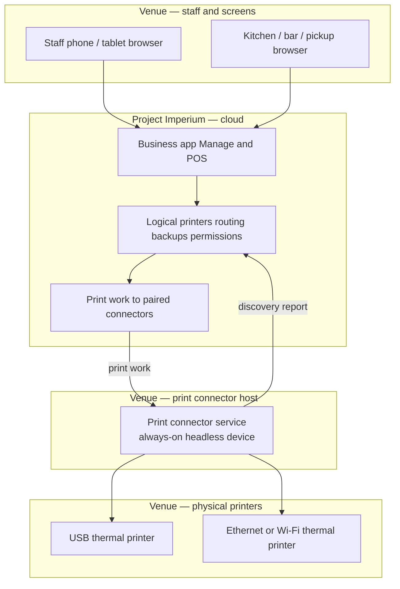
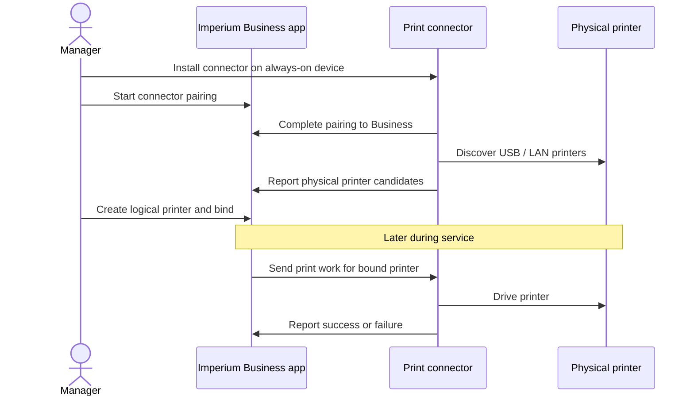

# ADR-0008: Cloud print path via venue print connector

- **Status:** Accepted
- **Date:** 2026-10-21

## Context

Project Imperium is cloud SaaS. Venue receipt and prep printers are ordinary local
devices (USB, Ethernet, or Wi‑Fi on the venue LAN). The browser and the cloud
cannot reliably discover or drive those printers: there is no public router API,
browser sandboxes block LAN printing for kitchen/receipt workflows, and OS print
dialogs are the wrong protocol for ESC/POS-style tickets.

Venues also need a **minimum hardware kit**: phones and optional screens first,
paper and bridges only when the venue chooses them — without Imperium imposing
device counts or brands.

Product behaviour for logical printers, binding, routing, backups, and screens
lives in the printers-and-screens subject. This ADR records the architecture
decision behind that path.

## Decision

1. **Staff and control-screen devices talk only to Imperium (cloud).** They never
   open local printer addresses, read the venue router, or act as the primary
   print driver for multi-device service.
2. **Paper on ordinary local printers uses Imperium's print connector** — a small
   always-on helper the venue runs on a local internet device (for example a
   Raspberry Pi, mini-PC, or docked spare tablet). Day-to-day the host is
   **headless infrastructure**, not a staff PC with monitor and keyboard.
3. **Bring-up is install → pair → discover → bind in Imperium**, not a local-only
   setup script that configures printers outside the product:
   - Install the connector so it starts on boot.
   - Pair it to the Business (manager starts in Imperium; connector completes).
   - Connector discovers USB/LAN printers and reports candidates to Imperium.
   - Managers create logical printers and bind them in the Business app.
4. **Logical printer + binding** remains the product model: configuration and
   routing survive hardware swaps; rebinding points at another physical target.
5. **Own connector is the primary path.** Manufacturer cloud-print targets may
   appear as optional physical targets under the same binding model; they are
   not the only supported path.
6. **Minimum kit:** a connector is required only when the venue prints through
   that path. Prep paper and dedicated screens stay optional; go-live does not
   require a receipt printer.

## Architecture

## Consequences

**Positive**

- Matches how cloud restaurant POS products reach local printers.
- Keeps the SaaS product free of on-premise deployment while still supporting
  brand-agnostic hardware.
- Lets small venues start with phones + optional screens + one receipt printer
  and one connector (or screens-only prep), then add printers without redesign.

**Negative / trade-offs**

- Venues that want paper on classic LAN/USB printers must keep at least one
  always-on connector device during service.
- Connector health, offline detection, and backup failover become operational
  concerns (already committed in printers-and-screens).

**Follow-ups**

- Implement connector install (boot service), pairing to the Business, discovery
  reporting, job delivery, and success/failure reporting against the product
  commitments. Binding and routing stay in the Business app — not a standalone
  local configuration script.
- Optionally expose manufacturer cloud-print as a secondary physical-target type
  without changing logical-printer configuration.
