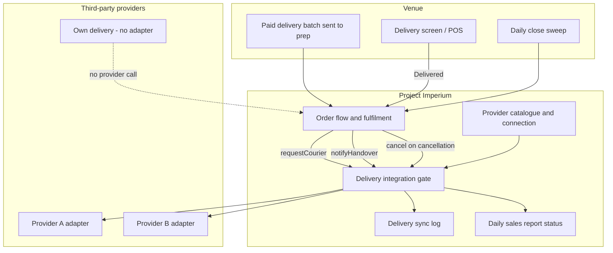

# ADR-0009: Provider-agnostic courier integration boundary

- **Status:** Accepted
- **Date:** 2026-10-26

## Context

Project Imperium serves venues in different countries and regions. The
third-party delivery company a venue uses will differ by market, and no single
provider is chosen for stage 1. Venues must still be able to run delivery with
no provider connected, and some venues run no prep or delivery screens at all.

The product already owns the delivery order, the batch, the handover pass, the
delivery screen, and the daily close. The missing piece is a boundary that can
call any future courier provider without hard-coding one provider into the order
flow, the delivery screen, or the daily report.

Three operational facts shape the decision:

1. The courier request must happen when the paid delivery batch is **sent to
   prep**, because the venue may use no screens.
2. Venue staff may mark Delivered on a screen, but many venues will not. The
   courier's own app is the operational source of truth for pickup and last
   mile.
3. A venue that records no staff handover — no screen and no POS action — has no
   handover event, so its delivery is reconciled by the daily sales report close.

Product behaviour for delivery methods, provider connections, and provider
events lives in the delivery-integrations subject. This ADR records the
architecture decision behind that boundary.

## Decision

1. **One provider-agnostic delivery-integration boundary.** Order flow, screens,
   and reports call the boundary; they never call a provider directly.
2. **Global provider catalogue plus per-business connection.** Superadmin
   maintains providers and country/region availability. A Business connects at
   most one provider. `Own delivery` is a method, not an adapter, and makes no
   provider calls.
3. **Three outbound events only:**
   - `requestCourier` when a paid delivery batch is sent to prep;
   - `notifyHandover` when staff mark the batch Delivered on a screen;
   - `cancelCourier` when a delivery order is cancelled before handover.
   A refund alone does not trigger cancellation.
4. **No inbound provider state in stage 1.** The provider's courier app owns
   pickup, last mile, and proof of delivery. Project Imperium does not ingest
   courier webhooks or poll provider delivery status.
5. **Batch send is the request trigger, independent of screens.** The request
   carries a `readyAt` drawn from the batch deadline. There is no ready-time
   update event; a late kitchen is handled in the provider's own app.
6. **The local outcome is the source of truth.** A failed provider call never
   blocks the physical handover, local Delivered status, or daily close. Calls
   retry with backoff; exhausted retries alert managers on duty.
7. **Venues with no staff handover reconcile at daily close.** Without a screen
   or POS handover action there is no `notifyHandover`; the close sweep
   completes undelivered slices. The daily report surfaces request status,
   handover status (`not used` when absent), and completion source.
8. **Credentials are write-only.** A connection stores provider credentials that
   the platform may use but no screen ever displays again. Staff sign-in
   credentials remain personal to each User.
9. **The sync log is operational, not audit.** Attempts are retained for
   troubleshooting under the delivery order's operational retention.
10. **Stage 1 ships `Own delivery` and an empty provider catalogue.** Provider
    adapters are tested with internal test doubles, never a production-visible
    test provider.

## Provider contract

Names below are the canonical integration vocabulary. They are provider-facing
integration names, not product-domain terminology.

### `requestCourier`

```ts
{
  event: "request";
  businessId: string;
  batchId: string;
  orderCode: string;
  externalDeliveryId?: string;
  requestedAt: string;
  readyAt: string;
  pickup: {
    name: string;
    address: string;
    phone: string;
  };
  dropoff: {
    name: string;
    phone: string;
    address: string;
    instructions?: string;
  };
  items: Array<{
    name: string;
    quantity: number;
    notes?: string;
  }>;
  total: number;
  currency: string;
  prepaid: true;
  idempotencyKey: string;
}
```

### `notifyHandover`

```ts
{
  event: "handover";
  businessId: string;
  batchId: string;
  externalDeliveryId: string;
  handedOverAt: string;
  idempotencyKey: string;
}
```

### `cancelCourier`

```ts
{
  event: "cancel";
  businessId: string;
  batchId: string;
  externalDeliveryId: string;
  cancelledAt: string;
  reason: string;
  idempotencyKey: string;
}
```

### Provider response

```ts
{
  externalDeliveryId: string;
  courier?: {
    name?: string;
    phone?: string;
  };
  eta?: string;
  trackingUrl?: string;
  status: string;
}
```

### Provider catalogue entry

```ts
{
  providerKey: string;
  displayName: string;
  supportedCountries: string[];
  supportedRegions?: string[];
  capabilities: Array<"request" | "handover" | "cancel">;
  credentialFields: string[];
  supportContact: string;
  docsUrl: string;
  enabled: boolean;
}
```

### Business connection

```ts
{
  providerKey: string;
  credentials: Record<string, string>; // write-only
  status: "connected" | "disabled" | "error";
  connectedBy: string;
  connectedAt: string;
  lastTestedAt?: string;
  lastError?: string;
}
```

### Delivery sync log

```ts
{
  deliveryId: string;
  providerKey: string;
  event: "request" | "handover" | "cancel";
  externalDeliveryId?: string;
  attempt: number;
  requestId: string;
  responseCode?: number;
  errorCode?: string;
  errorMessage?: string;
  createdAt: string;
}
```

## Architecture



```mermaid
sequenceDiagram
  actor Staff
  participant App as Imperium order flow
  participant Gate as Delivery gate
  participant Provider as Courier provider
  participant Courier as Courier app

  App->>Gate: requestCourier(batch, readyAt)
  Gate->>Provider: Dispatch request
  Provider-->>Gate: externalDeliveryId, courier, eta
  Note over App,Courier: Courier app owns pickup and last mile
  Staff->>App: Mark Delivered on screen (optional)
  App->>Gate: notifyHandover(batch, externalDeliveryId)
  Gate->>Provider: Handover notice
  Provider-->>Gate: Acknowledgement
  Note over App: No screen? Skip handover; daily close reconciles
```

## Consequences

**Positive**

- One boundary supports many providers without rewriting order flow, screens,
  or reports.
- Venues with no provider, no screen, or both still run delivery normally.
- The provider's courier app stays authoritative for pickup and last mile.
- New providers are catalogue entries and adapters, not product forks.

**Negative / trade-offs**

- Without inbound provider state, Project Imperium cannot show live courier
  tracking or prove customer receipt.
- A venue with no recorded staff handover has no handover time, so timed delivery
  review email is skipped for close-swept deliveries.
- Provider-specific quirks live behind adapters, so each new provider needs its
  own contract testing.
- A failed provider call can leave the provider's state behind the venue's local
  state until retry succeeds or a manager intervenes.

**Follow-ups**

- Implement the delivery-integration gate, provider catalogue, connection
  settings, sync log, retries, and manager failure alerts.
- Add the first real provider adapter when a provider and API access are chosen.
- Surface the delivery-integration status and exceptions on the daily sales
  report.
- Keep courier assignment and last-mile tracking outside Project Imperium until
  a future integration decision says otherwise.
