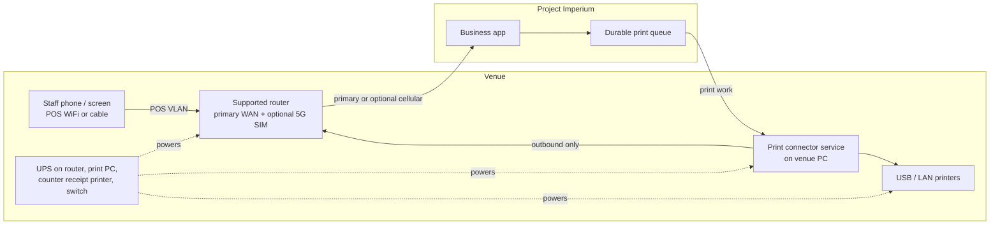

# ADR-0011: Local connectivity, primary WAN, optional fallback, and the print queue

- **Status:** Accepted
- **Date:** 2026-10-27

## Context

Project Imperium is online-only: the product has no offline mode and no offline
write queue (ADR-0006, realtime-and-concurrency). That is a deliberate product
position, not an oversight. A venue that prints or runs control screens therefore
depends on a working internet path, and the print connector that bridges the cloud
to local printers must be reachable from the cloud.

The venue also has a local network that must be separated from guests. The
connector and printers sit on the venue LAN; screens and staff devices reach the
cloud over the same router. If the WAN drops, the cloud is unreachable and the
connector cannot receive work. If the router dies, nothing on the venue network
reaches the cloud.

The product therefore needs a supported baseline (a router the venue can buy, a
primary WAN that passes a test, a dedicated POS network, and power resilience),
plus an optional cellular fallback that a venue can add without changing the
product model.

## Decision

1. **Online-only stands.** This ADR adds a supported connectivity baseline and an
   optional fallback; it does not introduce an offline product mode or an offline
   write queue.
2. **The venue buys and configures a supported router** from Project Imperium's
   list, using the onboarding guide. Project Imperium sells no router, SIM, or
   data plan. The router must support WiFi, a **dedicated POS SSID/VLAN** separate
   from guest WiFi, and a **primary WAN** that passes the onboarding test: 10 Mbps
   down / 2 Mbps up / under 100 ms round-trip.
3. **A 5G SIM is optional and recommended.** When installed, it is automatic
   failover behind the primary WAN. 5G is preferred; 4G LTE is acceptable where
   5G is unavailable, with a signal check. The failover test runs only for venues
   with a SIM. A **5G-only venue is not supported**: the primary WAN is required.
4. **No spare router is required.** The router is a single point of failure and
   the product does not hide that. The venue sizes its own SIM data plan and owns
   carrier data-cap alerts; the product does not monitor the carrier cap. The
   product's fallback alert is about the active path, not the data plan.
5. **Power resilience is part of the kit.** A UPS covers the router, every print
   PC (or a laptop on battery), the counter receipt printer, and the network
   switch. Prep output resilience is the venue's choice, because the product does
   not track prep output.
6. **The connector reports its active WAN path** (primary or cellular fallback) on
   each heartbeat. Managers on duty are alerted on a transition to fallback and
   again if the fallback is lost, only for venues with a SIM.
7. **Screens and staff devices use the POS network.** WiFi is the default; a wired
   connection is allowed where the hardware has a port. Bluetooth is a peripheral
   link and never an internet uplink.
8. **Print work survives the reconnect gap.** Jobs are durably queued server-side
   per logical printer and delivered idempotently after reconnect, with per-kind
   expiry: prep tickets expire quickly and drop with an alert; bills and receipts
   retry until the daily close sweep. A failed print is retried and alerted and
   **never blocks payment**.

## Architecture

## Consequences

**Positive**

- The venue has a testable connectivity baseline instead of an advisory router
  recommendation.
- A 5G SIM is a cheap, optional resilience add-on without becoming a mandatory
  carrier contract or a 5G-only deployment rule.
- The POS network is separated from guests without the product managing the
  router.
- The connector's reported WAN path makes fallback visible instead of silent.
- Idempotent, expiring print work prevents duplicate receipts and stale tickets.

**Negative / trade-offs**

- The venue carries the router, internet, and optional SIM/data cost.
- The router is a single point of failure; the product does not require a spare.
- A 5G-only venue cannot go live.
- The UPS adds hardware cost and is an onboarding attestation, not a live check.
- Venues with poor primary WANs or no 5G coverage may not meet the baseline.

**Follow-ups**

- Publish the supported-router list and onboarding guide, including the POS VLAN
  and failover test.
- Implement connector WAN-path reporting, the fallback transitions, and the
  durable per-printer queue with per-kind expiry.
- Keep the go-live checklist aligned with the core UPS and DK-port rules.

## Alternatives considered

- **Offline product mode.** Rejected: contradicts the stated online-only product
  position and would add a second write/conflict model.
- **5G-only venues.** Rejected: the primary WAN is the supported baseline; a 5G
  SIM is failover, not a replacement for venue internet.
- **Mandatory 5G SIM.** Rejected: coverage, cost, and carrier contracts make it a
  poor universal gate; it stays recommended.
- **Any router.** Rejected: the product cannot test or support arbitrary routers,
  VLAN behaviour, or failover.
- **Spare router or dual-router failover.** Rejected for v1: overkill for most
  venues and an operational burden; the product alerts when the venue is offline.
- **Cellular modem inside the connector only.** Rejected: narrower and cheaper,
  but it does not keep screens online, and most venues benefit from covering the
  whole service network.
- **Rely on staff phones' 5G.** Rejected: phones can reach the cloud, but the
  connector and screens cannot, so printing still stops.
