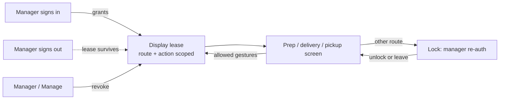

# ADR-0012: Display leases for control screens

- **Status:** Accepted
- **Date:** 2026-10-27

## Context

Prep, delivery, and pickup screens are shared physical surfaces at a venue. Staff
sign in with their own credentials, and staff-sessions forbids shared logins,
PINs, quick-switch, and in-app locks. The original product rule was that a
manager signs in on the device and leaves the screen open, and every action runs
as that signed-in manager.

That rule has two problems in service:

- With no expiry, the screen acts as the manager indefinitely — including after
  the manager goes home or leaves the company.
- A guard that navigates away and **signs off** turns an accidental back-swipe
  into a service outage until a manager returns: the exact friction the shared
  screen was meant to avoid.

A display surface needs a device grant that is scoped to a screen, survives
staff changes, and cannot be abused for money or configuration.

## Decision

1. **A control screen runs under a display lease**, not a staff session. A
   manager (or any user allowed to open that screen kind) opens it on the device;
   the lease authenticates **no person**.
2. **Scope.** A lease allows only its screen kind and that screen's history and
   reprint surfaces. It cannot reach payments, refunds, configuration,
   connectors, printers, or any other route.
3. **Lifetime.** A lease survives the manager signing out and does not expire
   mid-service. It ends on manager close, manager deactivation, device unpair, or
   manager revocation from Manage.
4. **Navigation does not end the lease.** Leaving the allowed routes shows a lock
   that requires manager re-authentication; the lease stays alive, so the pass
   screen keeps working once the blocked route is left or a manager unlocks.
5. **Server-side enforcement.** Route and action scope are enforced by the
   server, not only by client guards; reloads, back navigation, deep links, and
   second tabs all hit the same scope.
6. **Attribution.** Actions taken under a lease are recorded against the lease
   opener and the fact they were made under a lease. Whoever physically taps the
   device remains the opener's responsibility. Force-ready stays unaudited.
7. **Staff sessions stay intact.** A display lease is not a staff session and
   never replaces a person's own signed-in session for acting in Business.

## Architecture

## Consequences

**Positive**

- A shared screen keeps working across shifts, sign-outs, and accidental
  navigation without weakening staff-session identity.
- Device powers are bounded: a lease cannot move money or change configuration.
- Revocation and deactivation give a clean offboarding path.

**Negative / trade-offs**

- Adds a device-grant concept and a Manage surface for leases.
- Attribution is honest but coarse: the product knows the opener, not the tapper.
- Leases need cleanup on deactivation and device unpair.

**Follow-ups**

- Implement lease issuance, server-side route/action scoping, the lock surface,
  and lease listing/revocation in Manage.
- Mirror the clarification in the staff-sessions subject.

## Alternatives considered

- **Keep the manager session open.** Rejected: no expiry, stale authority, and a
  manager account left on a pass screen.
- **Sign off on navigation.** Rejected: an accidental gesture stops service and
  requires a manager to return.
- **Device accounts or kiosk mode.** Rejected: it becomes a shared login and
  contradicts the personal-session model.
