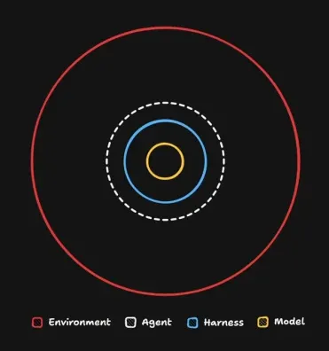

# Skills Reference

<br>

## Install Matt Pocock skills

```sh
npx skills@latest add mattpocock/skills
```

<br>

## Skills in opencode

We work with opencode. Depending on the AI provider, the config and location of skills can differ.

In opencode, skills are kept at:

```
~/.agents/skills
```

These are plain skills that the AI invokes automatically when the prompt matches the skill description.

<br>

### Disable auto-invoke

To make a skill manual-invoke only, add this property to the header:

*This line can differ depending on the AI provider.*

At opencode:

```
metadata: opencode/autoinvoke: false
```

<br>

At Claude
```
disable-model-invocation: true
```


<br>

### Invoke a skill with "/"

To invoke a skill with `/`, or to invoke a skill whose auto-invoke is disabled, create an opencode command reference at:

```
~/.config/opencode/command
```

Create an md file with the same name as the skill, using this body:

```md
---
description: Copy here the original description of the skill.
---

Use the Skill tool to load the `skill-name-as-the-original` skill, then follow its instructions.

$ARGUMENTS
```

### Scope

- Skills saved here are available **globally**.
- For **local-only** skills, use the same pattern and folder location, but at the root of the project.

<br>

## Agent clean up and pointers

- The agent must be extremely clean. Instead of pulling all references into context, it should **point** to them, so the agent grabs only what is necessary for the task.
- The `docs` folder is indispensable and very important. All reference and documentation is stored there, and `AGENTS.md` points to it.
- Every file pointer in `AGENTS.md` has a short description so the agent can recognize the file and decide what to load into context.
- The folder can be organized as we wish, but its documentation must always be up to date to avoid conflicts.

<br>



<br>

## File `coding-standards.md`

Core rules standard for the coding agent to keep the project uniform. It is used by the `/code-review` skill after all implementations done with the `/implement` skill.

<br>

## Starting the project with the Matt Pocock flow

Run the skills below in order. Each feeds the next; full descriptions live in each skill's `SKILL.md`.

**Invocation key**

- **User-invoked** — you type the command; the input it needs is shown below.
- **Internal** — another skill calls it. You generally don't type it, even where a `/command` exists.

### 0. Setup — required, once

**`setup-matt-pocock-skills`** · user-invoked, no argument

`/setup-matt-pocock-skills`

Interactive: it explores the repo, proposes an issue tracker, triage labels and domain-doc layout, and asks you to confirm before writing. Run it first; the tracker-dependent skills refuse to run without it. Re-run only to switch trackers or start over.

### 1. Triage incoming work — optional

**`triage`** · user-invoked, say the goal in natural language

`/triage show me anything that needs my attention` · `/triage let's look at #42` · `/triage move #42 to ready-for-agent`

Works the tracker's inbox: categorise (`bug` / `enhancement`), verify the claim against the code, grill it into shape if needed, then set a state (`needs-triage`, `needs-info`, `ready-for-agent`, `ready-for-human`, `wontfix`) and write an agent-ready brief. Skip it when you already know what to build. It calls `grilling` + `domain-modeling`, and its labels come from setup.

### 2. Sharpen the idea — optional

Do this only when you want to stress-test a plan before committing to it.

- **`grilling`** · internal — triggered by "grill me on…" phrasing, or called by `grill-me`, `grill-with-docs` and `triage`. Takes no invocation input; it interrogates whatever plan is in play.
- **`grill-me`** · user-invoked, needs the thing to grill:
  `/grill-me <the plan, decision or idea>` — pass a sentence or a file path. With nothing to grill, the interview has no subject.
- **`grill-with-docs`** · user-invoked, needs the thing to grill:
  `/grill-with-docs <the plan, decision or idea>` — same input as `grill-me`, plus it writes ADRs and the glossary as decisions land.

### 3. Spec — required

**`to-spec`** · user-invoked, no argument

`/to-spec`

Turns the current conversation into a spec and publishes it to the tracker. Run it after you've discussed the feature; it synthesizes that context, proposes the test seams for your approval, and labels it `ready-for-agent`.

### 4. Tickets — required

**`to-tickets`** · user-invoked, optional reference

`/to-ticket` (uses the conversation) · `/to-ticket <spec path, issue #, or URL>` (reads that instead)

Breaks the plan/spec into tracer-bullet vertical slices, each declaring the tickets that block it, and publishes them to the tracker in dependency order.

### 5. Implement — required (pick one)

- **`implement`** · user-invoked, needs the work to do:
  `/implement <ticket, spec or issue #>` — implements a single piece of work. Uses `tdd` at the agreed seams, runs typechecking/tests and then `code-review`, and commits to the current branch.
- **`implement-spec`** · user-invoked, needs a spec:
  `/implement-spec <spec>` — implements a whole spec by working its ticket graph on one integration branch, with implementer subagents in parallel worktrees; finishes with `code-review`.

### 6. Test as you build — required (auto)

**`tdd`** · internal — `implement` / `implement-spec` call it

No invocation input, but it expects the seams to have been agreed up front (they come from `to-spec`). It runs the red → green loop: one failing test at a seam, then only enough code to pass.

### 7. Review — required

**`code-review`** · internal by default; user-invoked, needs a fixed point

Called automatically at the end of `implement` / `implement-spec`. To run it yourself: `/code-review <fixed point>` — a commit, branch, tag, or `main` to diff against; with no argument it asks you for one.

Two-axis review of the diff: **Standards** (does it follow the repo's coding standards?) and **Spec** (does it match the issue/spec?), run as parallel sub-agents and reported side by side.

### Reference — not part of the flow

**`writing-for-agents`** · internal — a reference, never a session

No invocation input. The agent reaches it when authoring a skill, `AGENTS.md` / `CLAUDE.md`, or a pointered doc.

### Why this order

- **Setup first** — `triage`, `to-spec`, `to-tickets`, `implement`, `implement-spec` and `code-review` all fail without the tracker, labels and domain docs it writes.
- **Triage before picking up work** — clear the inbox of incoming issues/PRs and turn the good ones into agent-ready briefs.
- **Grill before spec** — sharpen the idea before freezing it into a spec.
- **Spec before tickets** — tickets are slices of the spec.
- **Tickets before implementation** — they are the task graph the implementation works the frontier of.
- **Review last** — it checks the finished diff against both standards and spec.
