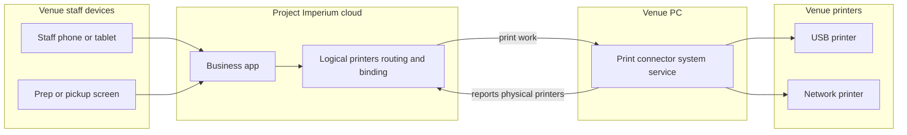

# Printers and screens

> **About this document.** This is the **target-state source of truth** for printers and screens in Project Imperium — how a venue registers output devices, routes tickets, and runs the prep and pickup surfaces that control fulfilment. It is written for two readers: AI agents that build the product and engineers onboarding onto it. It describes printers and screens as they are *meant to be* — capabilities are stated as commitments, without built/planned tags. It is self-contained: it links to no other document.

---

## 1. Scope

This subject owns **how work leaves the till and how stations see and control it**. It covers:

- **printers** — logical printers a venue configures, the **print connectors** that reach physical hardware, and the **binding** between them;
- the **print path** — staff devices talk only to Project Imperium in the cloud; Imperium hands print work to a venue **print connector**; the connector alone reaches the physical printers;
- the **connector bridge** — its host on the venue PC, per-connector identity and revocation, signed auto-updates, health reporting, the supported printer protocols, and the local connectivity and print queue that keep work flowing;
- **routing** — which printer and which prep area or station receive a ticket, by category, subcategory, and sales point;
- **backup printers** and what happens when a print fails;
- **per-employee print permissions** for issuing and reprinting documents;
- **cash drawers** — the optional physical latch wired to a **receipt printer**'s drawer-kick port, the per-staff **closing receipt printer override**, the **money events** that fire a **drawer kick**, and **manual open**;
- **prep areas and stations** — configurable main screens and sub-screens for kitchen, bar, and any other prep the venue defines;
- the **control screens** — kitchen, bar, delivery/runner, and the **customer pickup board** — their gestures, queues, and history; and
- the **handover scan** surface that reads a self-service **handover QR** or accepts its identification code and advances the selected or whole batch to **Delivered**; and
- how those surfaces advance **fulfilment status** on each prep-area slice of a batch (the orders subject owns the status model; this subject owns the surfaces and the print path).

It deliberately does **not** cover:

- the **order and batch** — composition, send, identification code, **guest allergen flags**, held and don't-make rules, and the fulfilment status vocabulary belong to the orders subject. This subject routes and displays what that subject sends — including a clear **allergen flag** on flagged order lines — and records the station actions that move status.
- the **sales point** — types, channels, and instances belong to the sales-points-and-instances subject. This subject uses a point as a **routing target** and as the place that names its receipt printer.
- **business goods and menu structure** — categories and subcategories belong to the business-goods subject. This subject routes by them.
- **billing and payment** — settlement belongs to the payments-and-tax subject.
- **customer bill and receipt content, numbering, and reprint/replacement identity** — the **receipts-and-bills** subject owns document kinds, required fields, bill and receipt numbers, and when a reprint or replacement applies. This subject **prints** those documents on the sales point's receipt printer, applies the **platform layout** of those required fields, and gates paper issue with **print permission**; it does not invent or omit required content. There is **no venue layout editor** and no optional marketing footer.
- **cash-out resume and cash-movement receipt content and numbering** — the **employee cash-out** subject owns those documents and when a cash movement is complete. This subject **prints** them on the receipt path (primary then **backup printer**) and raises print-failure when neither can print; movement completion still follows employee cash-out rules when paper fails after backup.
- the **employee cash session, expected business cash, cash-out, and cash movements** — the **employee cash-out** subject owns those. A cash drawer is hardware and never holds a balance, a wallet, or an obligation; this subject only opens it on the **money events** that subject defines as money movements.
- the **daily sales report close** — the sales-reports subject owns closing the day; this subject states the fulfilment sweep that close triggers.
- **notifications and emails** — their subjects own delivery; this subject names the print-failure condition that notifies managers.
- **courier provider calls and delivery-integration status** — the **delivery-integrations** subject owns the provider catalogue, connection, courier request, handover call, cancellation, retries, and no-handover reconciliation. This subject displays the provider sync state and exposes the retry action on the delivery screen.
- **hardware sales or lock-in** — Project Imperium sells no printers, screens, PCs, or print-connector hosts and requires no brand; the venue brings what it chooses within the supported printer protocols and the venue-PC host requirement (§3.1.1). Staff browser sessions stay one User each (staff-sessions subject), not a shared printer/screen login.
- **floor-plan placement** — where a logical printer or screen sits on a venue floor map belongs to the floor-plans subject. This subject owns creating and configuring those devices; a device may exist unplaced until a manager locates it on a floor. **Print connectors** are venue infrastructure and are **not** floor-plan objects.

---

## 2. Domain model and vocabulary

### Entities

- **Printer** — a **logical** output device the venue configures: a stable name, what it is for (receipt and/or prep), its routing participation, its optional **backup printer**, and its **binding** to physical hardware. The configuration survives hardware changes.
- **Cash drawer** — a physical latch wired to a **receipt printer**'s drawer-kick (DK) port. It has no network or software identity; Project Imperium never discovers or identifies it. A **drawer kick** is a pulse sent to the bound printer. A drawer is **not** a money object and has no balance, cash session, or obligation.
- **Closing receipt printer override** — an optional per-staff logical **receipt printer** used for that staff member's closure documents and **drawer kick** instead of the bill's sales-point receipt printer. Managers and above set it.
- **Print connector** — Project Imperium's always-on helper that runs on a **venue PC** — Windows 10/11 or macOS — that the venue owns. The PC may also run the POS or back office. The connector runs as a background **system service** under a dedicated non-admin OS user, starts on boot, and keeps running when staff sign out or close apps. It is the only path from the cloud product to ordinary venue printers: it discovers the physical printers the PC can reach on USB or the local network, reports them to Project Imperium, receives print work from Imperium, and drives those printers. Staff phones, tablets, and screens never talk to printers directly. A venue may run one or many connectors; one connector may expose many physical printers, and the cloud routes each job to the connector that can serve its bound printer.
- **Binding** — the link from a logical **printer** to one physical printer exposed by a **print connector** (or by an optional manufacturer cloud-print path treated as a physical target). Rebinding changes hardware without changing routing or permissions.
- **Connector pairing** — the one-time step that attaches a running print connector to a **Business** and issues its own **connector credential**. A manager starts pairing in Project Imperium and completes it on the connector host (for example with a short code); afterwards discovery, print work, health, and success or failure reports flow through that link. Pairing is revocable and re-pairing rotates the credential.
- **Prep area** — a configurable fulfilment zone (for example kitchen or bar) with one **main screen** and optional **stations**. A batch may produce one **fulfilment slice** per area that receives lines.
- **Station** (sub-area) — a named prep post under a prep area (for example salad, fry, dessert, cocktail rail) with its own **sub-screen**. Routing may send lines to a station.
- **Control screen** — an in-app surface opened under a **display lease**: a prep area's **main screen** or **sub-screen**, the **delivery screen**, or the **customer pickup board**. Screens are not registered hardware devices; any internet device may open them.

### Terms this subject introduces

- **Logical printer** — the configured **printer** entity, as opposed to the physical machine it is bound to.
- **Physical printer** — a real printer a **print connector** has discovered on its device or local network, or an equivalent target exposed by a manufacturer cloud-print path.
- **Venue PC** — the venue-owned laptop or desktop running Windows 10/11 or macOS that hosts the print connector. It may also run the POS or back office, must stay at the venue, and must be on whenever the venue can receive orders or print.
- **Receipt printer** — a logical printer used for customer-facing documents: receipts, bills, and kiosk handover tickets. At least one is required for each active payment sales point; points may share one.
- **Prep printer** — a logical printer used for kitchen/bar prep tickets. Optional; a control screen can carry the work instead. The product does not enforce or warn about prep output.
- **Minimum venue kit** — the hardware a venue must have to go live: a **venue PC** running a paired print connector; at least one **receipt printer** for each active payment sales point (points may share one) with a successful test print; a supported router on a dedicated **POS VLAN** with a **primary WAN**; and a UPS on the router, every print PC (or laptop battery), the counter receipt printer, and the network switch. Prep printers, control screens, and the optional 5G SIM are the venue's choice. The product does not check whether a prep area has a printer or a screen.
- **Primary WAN** — the venue's main internet path through the supported router, which must pass the onboarding speed and latency test. The 5G SIM is optional failover, never a primary path.
- **POS VLAN** — the dedicated network and SSID for the venue PC, printers, screens, and staff devices, separate from guest WiFi.
- **Display lease** — a route- and action-scoped device grant opened by a manager so a control screen can run at a location. It is not a staff session and authenticates no person.
- **Connector credential** — the per-connector identity issued at pairing, listed with the connector in Manage, and revocable. Re-pairing issues a fresh credential.
- **Cellular fallback** — the venue's optional 5G SIM path, used automatically when the primary WAN is unavailable. The connector reports which path is active. A venue without a SIM has no fallback and no cellular-fallback alert.
- **Print work queue** — the server-side durable queue of print jobs per logical printer, delivered to a connector idempotently after reconnect. It is print work, not an offline product mode, and a failed print never blocks payment.
- **Backup printer** — another logical printer named as failover for a primary; used automatically when the primary cannot print.
- **Routing rule** — a rule that matches category and/or subcategory and/or sales point and sends matching lines to a prep area, optional station, and/or prep printer. More specific matches win.
- **Default prep target** — the venue's required fallback when no routing rule matches a line.
- **Main screen** — the chef or head-of-area control surface for a prep area; it gates **Preparing** and area **Ready**.
- **Sub-screen** — a station's control surface; it receives tickets only after the main screen has marked them **Preparing**, and only for lines routed to that station.
- **Delivery screen** — the runner surface that shows ready work to take out, in time order, with colour by fulfilment state; it also shows the **courier request status**, the **courier handover status**, any **cancellation error**, the last provider error, and a retry action for a connected provider.
- **Handover scan** — a control-screen action on the POS or delivery screen that reads a self-service **handover QR** (or accepts the identification code as a fallback) and sets the selected Ready slices or the whole batch Delivered. It is not a shared login; it runs under the screen's display lease and attributes to the lease opener.
- **Customer pickup board** — a counter-facing display of order codes in pending, in progress, and ready-for-pickup columns for self-pickup, kiosk, and on-premises to-go collection. It is display-only; staff scan on the POS or handover surface.
- **Display mode** — a locked presentation of the customer pickup board under a display lease, safe to leave facing guests (codes and status only — no prices, names, or payment detail).
- **Force-ready** — a main-screen choice to mark every open station line on a ticket done and set the area slice **Ready** when sub-screens are still incomplete.
- **Print permission** — a per-employee capability that gates who may issue or reprint customer and prep prints.
- **Drawer kick** — the best-effort pulse command sent to a **receipt printer**'s DK port on a **money event** or **manual open**. It is not a document and never prints.
- **Money event** — a closed list of cash-affecting acts that fire a drawer kick (§3.12).
- **Manual open** — an explicit, audited request to open a bound drawer that is not a sale or other money event.

Terms reused rather than redefined here: **Business**, **Batch**, **Identification code**, **Handover pass**, **Handover QR**, **Fulfilment slice**, **Fulfilment status** (**Sent**, **Preparing**, **Ready**, **Delivered**), **Held batch**, **Don't make**, **guest allergen flags**, **Sales point**, **Menu category**, **Menu subcategory**, **Business good**, **Deadline**, **courier request**, **courier handover**, **delivery method**, **Own delivery**, **managers on duty**, **managers and above**, **soft delete**, and **daily sales report**.

---

## 3. Capabilities

### 3.1 Hardware stance

- **Required kit.** An operating venue has a **venue PC** (Windows 10/11 or macOS) running a paired **print connector**, at least one **receipt printer** for each active payment sales point (points may share one), a supported router on a dedicated **POS VLAN** with a **primary WAN**, and the core **UPS**. Project Imperium sells none of it and locks the venue to no brand within the supported printer protocols and PC platforms.
- **Screens are optional.** Control screens always exist as app pages. A manager opens one under a display lease; using a screen is the venue's choice. The product does not check whether a prep area has a screen, a printer, or either.
- **Prep paper is optional.** The venue chooses whether a prep area uses a printer, a screen, both, or neither. The product offers both and does not enforce output completeness.
- **Paper is the normal receipt path.** Every active payment sales point has a receipt printer. A print failure **never blocks payment**: the customer pays, may leave without a receipt, and may receive it by email when an address is provided (§3.4).
- **The venue PC is a shared venue machine.** It may run the POS or back office. The connector is a system service under a dedicated non-admin OS user, starts on boot, and is not a staff session. The PC stays at the venue and is on whenever the venue can receive orders or print.
- **Printer-only and screens-only prep** are both valid. A venue may run paper at every prep point, screens at every prep point, or any mix; nothing enforces the choice.
- **Staff identity** is the **signed-in User** on that browser session — personal or venue-provided device (staff-sessions subject). Printers, screens, and print connectors are output, control, or bridge surfaces — not a shared staff login, PIN, or quick-switch.
- **Control screens** always exist in the product. A manager opens a screen by granting it a **display lease**; connecting a dedicated display at a location is optional and does not change the service flow. The lease is a device grant, not a person's staff session.

#### 3.1.1 Connector host, supported printers, and local connectivity

- **Host.** A **print connector** runs on a **venue PC** — a laptop or desktop running Windows 10/11 or macOS — that the venue owns. The PC may also run the POS or back office, must stay at the venue, and must be on whenever the venue can receive orders or print. The connector is a **system service** under a dedicated non-admin OS user, starts on boot, and keeps running when staff sign out or close apps. Sleep is disabled; OS updates are scheduled outside service; the venue applies the antivirus exclusion guide. The venue supports the PC's hardware and OS; Project Imperium supports the connector only. ChromeOS and Linux are not supported hosts.
- **Supported printers.** Project Imperium supports printers that speak standard receipt and label protocols over USB or the local network — for example ESC/POS, Star Line Mode, ZPL, ePOS, and raw network/USB. For printers in different areas, network printers are preferred; a USB printer is served by the PC it is plugged into. Printers that work only through a vendor's OS driver, and certified fiscal devices, are **out of scope**. A manufacturer cloud-print target remains an optional physical target under the same binding model. The connector may use the OS spooler in raw/passthrough mode; it does not depend on vendor rendering.
- **Screens and staff devices.** Screens and staff devices reach the cloud over the venue router's **WiFi** or cable. A wired connection is allowed but never required. Bluetooth is a short-range peripheral link, **never** an internet uplink.
- **Router and POS network.** The venue uses a **supported router** from Project Imperium's list, configured from the onboarding guide. It must support WiFi, a **dedicated POS SSID/VLAN** separate from guest WiFi, and a **primary WAN** that passes the onboarding test (10 Mbps down / 2 Mbps up / under 100 ms round-trip). The venue PC, printers, screens, and staff devices use the POS network; guest devices use the separate guest network. The venue supplies the router and pays for its internet and any SIM data; Project Imperium sells none of it.
- **Optional cellular fallback.** A **5G-capable SIM** in the router is **recommended but optional**. When present, it is automatic failover behind the primary WAN; 5G is preferred, and 4G LTE is acceptable where 5G is unavailable. A venue without a SIM has no fallback. A 5G-only venue is not supported: the primary WAN is required. No spare router is required; the venue sizes its data plan and owns carrier cap alerts.
- **Power.** A **UPS** covers the router, every print PC (or a laptop on battery), the counter receipt printer, and the network switch. Prep output resilience is the venue's choice.
- **Observability.** The connector reports its **active WAN path** (primary or cellular fallback) on each heartbeat. Managers are alerted on a transition to fallback and again if the fallback is lost, only for venues with a SIM (notifications subject).

### 3.2 Print connectors, printers, and binding

- Staff devices and control screens talk **only to Project Imperium in the cloud**. They do not discover, open, or drive venue printers on the local network or by USB. Project Imperium does not read the venue router and does not reach ordinary local printers by itself.
- Each venue that prints runs one or more **print connectors** on its **venue PC**. The PC may also run the POS or back office; it stays on whenever the venue can receive orders or print. The connector runs as a system service; a temporary local pairing page or tray app is used only during setup, and there is no local API after pairing. There is no hard product limit on the number of connectors; each is paired and revoked independently.
- **Bring-up order** (not a local-only setup script that replaces Manage):
  1. Install and start the print connector as a system service on the venue PC so it runs on boot.
  2. **Pair** the connector to the business from Project Imperium (manager starts pairing in the app; the connector completes it on the PC).
  3. The connector **discovers** reachable physical printers and **reports** them to Imperium.
  4. Managers **create logical printers** and **bind** each one to a reported physical printer (and set backups and routing) **in Project Imperium**. Naming, routing, and binding are not done as a one-off local script outside the product.
- After pairing, the connector receives print work from Imperium and drives the bound physical printer. Discovery stays local to the connector; the cloud only sees what connectors report.
- Managers and above create **logical printers** with the full configuration the venue needs (name, receipt and/or prep role, backup, participation in routing). A single printer may be both a receipt and a prep printer.
- Each logical printer is **bound** to one physical printer on a connector. If hardware fails or moves, staff **rebind** the same logical printer to another physical printer; routing and permissions stay.
- The **print connector is the primary path** for venue paper. Manufacturer cloud-print paths may expose a physical target the same way as an optional secondary path; binding stays the model either way.
- A venue that issues receipts or bills must have at least one configured **receipt printer** with a usable binding for **each active payment sales point**; points may share one. Prep printers are optional. A connector is required on the venue PC for paper printing.

### 3.2.1 Print path at a glance

Staff and screens use only the cloud product. Paper leaves the venue through a paired connector (or an optional manufacturer cloud-print target bound the same way).

#### 3.2.2 Connector identity, lifecycle, and health

- **Identity.** Each connector receives its **own credential** when paired, scoped to that Business. There is no shared global connector secret, and a connector never acts for another Business.
- **Manage surface.** Paired connectors appear in Manage with name, version, status, last heartbeat, and active WAN path. A manager can rename or **revoke** a connector.
- **Revocation.** Revocation ends trust immediately: the connector receives no further print work and its reported printers stop being bindable. Re-pairing issues a fresh credential. A lost, replaced, or decommissioned connector is revoked rather than left trusted.
- **Updates.** Connectors take **signed auto-updates** on by default, rolled out in stages. Each reports its running version; the cloud **refuses print work below a minimum supported version** and alerts managers rather than silently accepting a stale agent.
- **Hardening.** A connector starts on boot, auto-restarts after a crash, and restarts itself if it hangs; it **never reboots the venue PC**. It exposes **no local API or web page after pairing**; a temporary local pairing page or tray app is used only during setup. It connects **outbound only** and is a system service, not a staff session.
- **Health and failure.** A connector that misses its heartbeat is **offline**: it is shown as offline in Manage, its bound printers cannot print, and managers are alerted. Backup printers still apply; if none is usable, the print fails with a clear error and is retried. Customer payment is never blocked (§3.4).
- **Print work queue.** Print work is durably queued server-side per logical printer and delivered after a connector reconnects. Delivery is **idempotent**, so a retried job never prints a duplicate receipt or ticket. **Prep tickets** expire quickly and are dropped with an alert rather than printed stale; **bills and receipts** retry until the business day's close sweep (§3.10). A failed print is retried and alerted and never blocks payment. The queue is server-side print work, not an offline product mode, and it never unblocks a person's otherwise blocked write.
- **Diagnostics.** The connector uploads health, error logs, printer status, and print-job metadata — **no document content**. It does not expose the venue PC to remote desktop.

### 3.3 Prep areas, stations, and routing

- Under business configuration, the venue defines named **prep areas** and optional **stations**, each area's main and sub-screens, and **routing rules** from category, subcategory, and sales point to area, station, and prep printer. Suggested defaults (for example Kitchen and Bar) are offered; they are not mandatory.
- On send, a batch may produce a **fulfilment slice** for each prep area that receives at least one line. Food and drinks (and any other configured areas) run on **independent timelines**: drinks may become Ready and Delivered while food is still Preparing.
- Set-menu components follow each component's category into the right area. Lines that need no prep create no slice.
- Routing uses **most specific rule wins**. One batch may fan out across areas and stations. Unmatched prep lines use the venue's **default prep target**.
- **Receipt and bill printing** does not use prep routing: each sales point (including kiosk and delivery as needed) names which **receipt printer** it uses. Kiosk handover tickets print on that point's receipt printer.

### 3.4 Backup printers and print failure

- Each logical printer may name **one backup printer**. When the primary is unavailable (marked offline or detected failed), output goes to the backup automatically. Screens have no backup device.
- If the primary fails and there is no usable backup, the print **fails with a clear error** and is retried — it is never silently skipped. Customer payment is never blocked; the customer may leave without a receipt and may receive it by email when an address is provided. Prep screen flow and order taking continue. Staff retry or a manager rebinds or changes routing.
- A failed print **notifies the managers on duty** (or all manager-layer users for the business if none are on duty). Detecting the failure belongs to this subject; delivering the alert belongs to the notifications subject.
- A **drawer kick** follows the same logical printer and backup, but its failure is **best-effort** and never blocks the money event (§3.12).

### 3.5 What prints

- This subject prints **prep tickets** (when a route names a prep printer), **customer receipts**, **bills**, and **kiosk handover tickets**.
- A **drawer kick** is not a document and is never queued by report, prep, kiosk, or reprint work; it fires only on the money events in §3.12.
- A **kiosk handover ticket** carries the **handover QR** and identification code, in the same **Handover** block as the receipt. A **delivery receipt** carries the **order reference** only and no handover QR. The **review QR** stays in its separate block.
- Prep paper is optional per route; the control screens always show the work. Customer documents print on the sales point's receipt printer. A failed print is retried and alerted and never blocks payment.
- Customer bill and receipt **content and numbering** come from the receipts-and-bills subject. This subject owns **paper presentation only**: a fixed **platform layout** of the required fields on the sales point's receipt printer. Venues do **not** design templates, reorder fields, or add optional marketing content. A paper **reprint** of an unchanged bill or receipt keeps that subject's number and reprint mark; layout still follows current routing and backup rules and is audited. Screens and email show the **same required content** (receipts-and-bills); screens re-show work from **history** rather than reprinting.
- On **prep tickets** and **prep control screens**, every order line that carries **guest allergen flags** shows a clear **allergen flag** together with the allergen names on that line. Unflagged lines on the same ticket or screen look normal — one batch, one identification code, no separate allergen-only ticket. The orders subject owns the flags; this subject owns making them unmistakable at the station.

### 3.6 Control screens — shared behaviour

- A control screen runs under a **display lease**: a route- and action-scoped device grant that a manager opens on the device at that location. Any user allowed on that screen kind may then use it under the lease. The lease is **not a staff session** and authenticates **no person**.
- **Scope.** A lease allows only its screen kind and that screen's **history/reprint** surfaces. It cannot reach money, refunds, configuration, connectors, printers, or any other route.
- **Lifetime.** A lease survives the manager signing out and does not expire mid-service. It ends when a manager closes it, the manager is deactivated, the device is unpaired, or a manager revokes it from Manage.
- **Navigation.** Leaving the allowed routes shows a **lock** that requires manager re-authentication; it does **not** kill the lease, so an accidental back-swipe cannot stop the pass. The screen keeps working once the manager unlocks or the blocked route is left.
- **Revocation.** Managers can list and revoke active leases for the business. A deactivated manager's leases end.
- **Attribution.** Actions taken under a lease are recorded against the **lease opener** and the fact they were made under a lease. Force-ready remains unaudited (§3.7). Whoever physically taps the device is still the opener's responsibility.
- Gestures are **single-click** and **double-click** (or the equivalent pointer actions). Touch hardware is recommended at the pass but **not required**; mouse or trackpad works so venues that skip dedicated screens are not blocked.
- Every control screen has a **history** view to **look up and reprint** tickets already seen. History does **not** reverse fulfilment status, send work backward, or undo a station step — fulfilment is **forward-only** (realtime-and-concurrency; ADR-0006). Wrong lines are corrected on the order/bill path (void, cancel, don't-make — orders subject), not by moving a slice backward.
- **Held** batches appear at the end of the relevant queue, visually distinct, and are **not activatable** until released from the tab (release stays on the tab, as the orders subject defines).
- Batches whose orders are all **don't make** never appear on prep or delivery screens.

### 3.7 Kitchen and bar main and sub-screens

- Each prep area has one **main screen**. Optional **sub-screens** follow the chef or head of bar.
- Ready-to-make tickets appear on the **main screen** when the batch is sent. A **single-click** marks the area slice **Preparing**. A ticket appears on a **sub-screen** only after that Preparing action, and only if it has lines for that station. Flagged allergen lines remain visually distinct on main and sub-screens (§3.5).
- On a sub-screen, **double-click** marks that station's lines done. Many tickets may be Preparing at once. The main screen shows a **per-line done indicator** for station work.
- The main screen **double-click** sets the area slice **Ready** only when every sub-line for that ticket is done — or when the ticket has no station lines. If subs are still open, the main offers a choice: **wait**, or **force-ready** (mark all remaining station lines done and set Ready). Force-ready needs **no reason and is not audited**.
- The same main/sub pattern applies to every prep area the venue configures (kitchen, bar, merchandise counter, and so on).

### 3.8 Delivery screen, handover scan, and customer pickup board

- The **delivery screen** lists work in time order. Colours distinguish still preparing, ready to run, and done. For **delivery**, the batch is **whole-batch**: the Delivered action is blocked until every slice is Ready, then one action marks the whole batch Delivered and removes it from the queue. For dine-in and to-go runner work, a **Ready slice** may be marked Delivered on its own so early drinks do not wait for food.
- When the Business uses a connected **courier provider**, the delivery screen shows the **courier request status** (requested, failed, not connected, own delivery), the **courier handover status**, any **cancellation error**, the last error, and a **retry** action. A failed provider call never blocks the Delivered action.
- A venue with **Own delivery** shows no provider status and makes no provider calls; staff mark Delivered when they hand the batch to their own courier.
- The **handover scan** reads a self-service **handover QR** on the POS or delivery screen. **QR self-ordering** allows staff to select only the items whose slices are Ready; the pass remains usable for later scans. **Kiosk** and **delivery** hand over the whole batch after every slice is Ready. If the QR cannot be read, staff enter the identification code. A manager and above may override a missing pass; the override is recorded.
- The **customer pickup board** is opened under a display lease and left in **display mode** on a counter device. Guests do not log in. It shows order **identification codes** in columns for pending, in progress, and ready for pickup — progressive as slices become Ready, and complete when slices are Delivered. It shows no prices, guest names, or payment detail. It is display-only; scanning happens on the POS or handover surface.

### 3.9 Advancing status without screens

- Control screens are the preferred surface. The **POS** may also set a slice Preparing, Ready, or Delivered under the same entitlements, so printer-only or manual-calling venues keep a normal service flow.
- A venue may run delivery with **no screens at all**. The **courier request** is raised at batch send and does not depend on a screen. No **courier handover** call is raised without a staff handover action (delivery screen or POS); the provider's own app records pickup and the daily close completes the batch. The delivery screen status is simply absent rather than blocking service.

### 3.10 Daily close sweep

- When the **daily sales report closes**, every fulfilment slice for that business day that is not yet **Delivered** is moved to **Delivered** (advancing through Preparing and Ready as needed) so queues are clear. The sales-reports subject owns the close; this subject owns that fulfilment consequence.

### 3.11 Printer lifecycle

- A logical printer may be **deactivated** or removed from routing under the platform's soft-delete convention; print history remains. The venue cannot retire a receipt printer that is the **only one assigned to an active payment sales point** — another receipt printer must be assigned first. Backup links are cleared or reassigned on retire.

### 3.12 Cash drawers and the drawer kick

- **Hardware truth.** A cash drawer is a dumb electromechanical latch wired to a receipt printer's **drawer-kick (DK) port** (some printers expose two ports). It has no network or USB identity the cloud can see; Project Imperium does not discover it. The only software handle is the **receipt printer** the connector already drives. Smart cash recyclers with their own API are a future hardware class and out of scope here.
- **No drawer entity and no binding.** There is no separate drawer record and no staff-to-drawer binding. The drawer is whatever is physically plugged into the receipt printer that serves the closure. A printer with nothing on its DK port is a harmless no-op.
- **Closing receipt printer override.** A staff member may have one optional **closing receipt printer** set by managers and above. When set, that staff member's closure documents (bill and receipt) and drawer kick use it instead of the bill's sales-point receipt printer. When unset, the bill's sales-point receipt printer is used. This lets a cashier closing a transferred tab print and open at the counter rather than at the table. The logical printer's **backup printer** still applies.
- **Kick target.** The kick targets the **closing receipt printer** of the staff member whose wallet the cash enters or leaves: the staff member who records a bill payment or refund (the closer), the receiver for a peer cash-in, the affected employee for a house paid-in/out, and the employee being cashed out for a cash-out. If that staff member has no override, a bill event falls back to the bill's sales-point receipt printer; a non-bill event has no venue-wide default and the kick is a no-op. Manual open uses the acting staff member's override, or the receipt printer that serves the current closure.
- **Money events that kick.** A drawer kick is enqueued on:
  - each **payment** recorded on a bill, any method (cash, card, crypto, gift card, other), including each partial payment;
  - each **refund** recorded, any method;
  - each **peer cash-in**, **house paid-in**, **house paid-out**, and their **reverses**;
  - **cash-out approval**;
  - **manual open**.
- **Never kicks.** Reports, prep tickets, kiosk tickets, reprints, and configuration or document reprints; a **pre-payment bill** print (no money moved yet); an **order-line void without money**, a **manual discount**, or an **invitation**; a **gift-card grant** or **forfeiture**; and any settings or report download. A void that reverses a recorded payment is a **refund** and kicks as such.
- **Best-effort, never gating.** A drawer kick is fire-and-forget. It can ride on the receipt print job or be sent as a standalone kick when no receipt prints but a receipt printer is bound. A missing binding, offline printer, missing connector, or a printer with no drawer is a **no-op**: the money event still commits, and there is **no** "drawer did not open" gate. Document print failure follows §3.4; the kick does not.
- **No open/closed sensor in v1.** The product does not claim to know whether the drawer opened. Optional printer-specific sensor support is a later addition.
- **Manual open.** An on-duty employee may open a bound drawer manually; the act is **audited** (actor, time, printer) and is not a sale. Manual open does not use an operational reason catalogue.
- **Staff device is not the bridge.** A tablet or phone browser never reaches the drawer; the **print connector** sends the pulse to the printer. A venue that uses one **counter receipt printer** gets the drawer behaviour everywhere that printer serves bills; a mobile-only staff member with no receipt printer simply has no drawer.
- **Cash-taking venues.** A venue that records cash payments must have a receipt printer with a **DK port** at the counter or expeditor. A venue that never takes cash may use a receipt printer without a DK port.

---

## 4. Roles and entitlements

### Base access layers

| Layer | Printer and screen powers |
| --- | --- |
| **Customer** | Sees own order readiness on customer surfaces and the public-facing pickup board codes; never configures devices or routing. |
| **Employee** | Uses the control screens their job role or capability allows under a display lease; runs prep, delivery, handover-scan, and history gestures on those screens; retries a failed courier request or handover on the delivery screen; prints and reprints only with **print permission**; may open a bound cash drawer manually (audited). |
| **Supervisor** | Uses any Service control screen by default (prep, delivery, pickup) under a display lease; scans a handover pass and retries a failed courier call; prints and reprints with print permission by layer default; may open a bound cash drawer manually (audited). Does not configure connectors, printers, routing, or grant print permissions; does not override a missing handover pass. |
| **Manager** | Everything a supervisor can do, plus pairing and revoking connectors, granting and revoking display leases, configuring logical printers, bindings, backups, prep areas, stations, routing, print permissions, and a staff member's **closing receipt printer override**; and opening any control screen (including the pickup board in display mode). May override a missing handover pass with a recorded override. Receives print-failure, connector-offline, cellular-fallback (venues with a SIM), and delivery-integration-failure alerts when on duty. |
| **Admin/owner** | Everything a manager can do, with full venue control. |

### Who can do what

| Activity | Who |
| --- | --- |
| Install and pair print connectors; revoke a connector; view connector version, status, and WAN path; create, bind, rebind, and retire logical printers; set backups | Managers and above |
| Grant, list, and revoke display leases for control screens | Managers and above |
| Define prep areas, stations, and routing rules; assign sales-point receipt printers | Managers and above |
| Set a staff member's closing receipt printer override | Managers and above |
| Open a bound cash drawer manually | Any on-duty employee; audited |
| Grant per-employee print permissions | Managers and above |
| Issue or reprint receipts, bills, kiosk tickets, and prep tickets | Users with **print permission** (supervisor layer and above always; employees when granted) |
| Use kitchen / bar (or other area) main and sub-screens under a manager-granted display lease | Job roles for that area; supervisors; managers and above; employees with the granting capability |
| Use the delivery screen under a manager-granted display lease | Runner / service roles that deliver; supervisors; managers and above; employees with the granting capability |
| Use the customer pickup board and display mode under a manager-granted display lease | Supervisors; managers and above; employees granted the capability |
| Single-click Preparing; double-click station done; main Ready; force-ready | Users allowed on that area's screens under a display lease (attributed to the lease opener) |
| Double-click Deliver on a Ready slice (dine-in / to-go runner work) | Users allowed on the delivery screen |
| Mark a delivery batch Delivered as a whole after every slice is Ready | Users allowed on the delivery screen or POS |
| Scan a handover QR or enter the identification code at handover | Users allowed on the handover surface |
| Override a missing handover pass and mark Delivered | Managers and above (recorded) |
| Retry a failed courier request or courier handover | Users allowed on the delivery screen; managers and above |
| View / reprint from station history | That station's staff for their tickets; managers and above for any |
| Advance fulfilment status from the POS | Same entitlements as the matching screen action |
| Receive print-failure, connector-offline, cellular-fallback (venues with a SIM), and delivery-integration-failure notifications | Managers on duty (else all manager-layer users for the business) |
