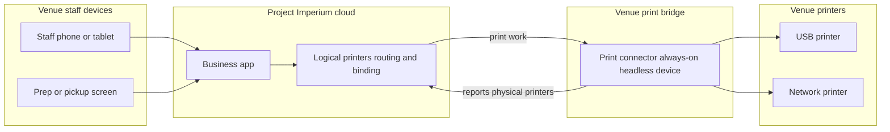

# Printers and screens

> **About this document.** This is the **target-state source of truth** for printers and screens in Project Imperium — how a venue registers output devices, routes tickets, and runs the prep and pickup surfaces that control fulfilment. It is written for two readers: AI agents that build the product and engineers onboarding onto it. It describes printers and screens as they are *meant to be* — capabilities are stated as commitments, without built/planned tags. It is self-contained: it links to no other document.

---

## 1. Scope

This subject owns **how work leaves the till and how stations see and control it**. It covers:

- **printers** — logical printers a venue configures, the **print connectors** that reach physical hardware, and the **binding** between them;
- the **print path** — staff devices talk only to Project Imperium in the cloud; Imperium hands print work to a venue **print connector**; the connector alone reaches the physical printers;
- **routing** — which printer and which prep area or station receive a ticket, by category, subcategory, and sales point;
- **backup printers** and what happens when a print fails;
- **per-employee print permissions** for issuing and reprinting documents;
- **prep areas and stations** — configurable main screens and sub-screens for kitchen, bar, and any other prep the venue defines;
- the **control screens** — kitchen, bar, delivery/runner, and the **customer pickup board** — their gestures, queues, and history; and
- the **handover scan** surface that reads a self-service **handover QR** or accepts its identification code and advances the selected or whole batch to **Delivered**; and
- how those surfaces advance **fulfilment status** on each prep-area slice of a batch (the orders subject owns the status model; this subject owns the surfaces and the print path).

It deliberately does **not** cover:

- the **order and batch** — composition, send, identification code, **guest allergen flags**, held and don't-make rules, and the fulfilment status vocabulary belong to the orders subject. This subject routes and displays what that subject sends — including a clear **allergen flag** on flagged order lines — and records the station actions that move status.
- the **sales point** — types, channels, and instances belong to the sales-points-and-instances subject. This subject uses a point as a **routing target** and as the place that names its receipt printer.
- **business goods and menu structure** — categories and subcategories belong to the business-goods subject. This subject routes by them.
- **billing and payment** — settlement belongs to the payments-and-tax subject.
- **customer bill and receipt content, numbering, and reprint/replacement identity** — the **receipts-and-bills** subject owns document kinds, required fields, bill and receipt numbers, and when a reprint or replacement applies. This subject **prints** those documents on the sales point's receipt printer, applies the **platform layout** of those required fields, and gates paper issue with **print permission**; it does not invent or omit required content. There is **no venue layout editor** and no optional marketing footer.
- **cash-out resume and cash-movement receipt content and numbering** — the **employee cash-out** subject owns those documents and when a cash movement is complete. This subject **prints** them on the receipt path (primary then **backup printer**) and raises print-failure when neither can print; movement completion still follows employee cash-out rules when paper fails after backup.
- the **daily sales report close** — the sales-reports subject owns closing the day; this subject states the fulfilment sweep that close triggers.
- **notifications and emails** — their subjects own delivery; this subject names the print-failure condition that notifies managers.
- **courier provider calls and delivery-integration status** — the **delivery-integrations** subject owns the provider catalogue, connection, courier request, handover call, cancellation, retries, and no-handover reconciliation. This subject displays the provider sync state and exposes the retry action on the delivery screen.
- **hardware sales or lock-in** — Project Imperium sells no printers, screens, or print-connector devices and requires no brand; the venue brings what it chooses. Staff browser sessions stay one User each (staff-sessions subject), not a shared printer/screen login.
- **floor-plan placement** — where a logical printer or screen sits on a venue floor map belongs to the floor-plans subject. This subject owns creating and configuring those devices; a device may exist unplaced until a manager locates it on a floor. **Print connectors** are venue infrastructure and are **not** floor-plan objects.

---

## 2. Domain model and vocabulary

### Entities

- **Printer** — a **logical** output device the venue configures: a stable name, what it is for (receipt and/or prep), its routing participation, its optional **backup printer**, and its **binding** to physical hardware. The configuration survives hardware changes.
- **Print connector** — Project Imperium's small always-on helper that runs on a local internet device at the venue. That device is **infrastructure left plugged in** (for example a mini computer or single-board computer) — not a staff workstation with screen and keyboard for daily use. After install it normally runs **headless**. It is the only path from the cloud product to ordinary venue printers: it discovers the physical printers that device can reach on USB or the local network, reports them to Project Imperium, receives print work from Imperium, and drives those printers. Staff phones, tablets, and screens never talk to printers directly. A venue may run one or many connectors; one connector may expose many physical printers.
- **Binding** — the link from a logical **printer** to one physical printer exposed by a **print connector** (or by an optional manufacturer cloud-print path treated as a physical target). Rebinding changes hardware without changing routing or permissions.
- **Connector pairing** — the one-time step that attaches a running print connector to a **Business** so Imperium trusts it. A manager starts pairing in Project Imperium and completes it on the connector device (for example with a short code); afterwards discovery, print work, and success or failure reports flow through that link.
- **Prep area** — a configurable fulfilment zone (for example kitchen or bar) with one **main screen** and optional **stations**. A batch may produce one **fulfilment slice** per area that receives lines.
- **Station** (sub-area) — a named prep post under a prep area (for example salad, fry, dessert, cocktail rail) with its own **sub-screen**. Routing may send lines to a station.
- **Control screen** — an in-app surface opened after sign-in: a prep area's **main screen** or **sub-screen**, the **delivery screen**, or the **customer pickup board**. Screens are not registered hardware devices; any internet device may open them.

### Terms this subject introduces

- **Logical printer** — the configured **printer** entity, as opposed to the physical machine it is bound to.
- **Physical printer** — a real printer a **print connector** has discovered on its device or local network, or an equivalent target exposed by a manufacturer cloud-print path.
- **Receipt printer** — a logical printer used for customer-facing documents: receipts, bills, and kiosk handover tickets.
- **Prep printer** — a logical printer used for kitchen/bar prep tickets. Prep printing is optional; control screens always show the work.
- **Minimum venue kit** — the product goal that a business can operate with as little hardware as it chooses: staff phones (or other browser devices), optional control-screen devices, optional printers, and — only when paper printing is used with ordinary local printers — at least one **print connector**. Project Imperium does not impose how many of each the venue must buy.
- **Backup printer** — another logical printer named as failover for a primary; used automatically when the primary cannot print.
- **Routing rule** — a rule that matches category and/or subcategory and/or sales point and sends matching lines to a prep area, optional station, and/or prep printer. More specific matches win.
- **Default prep target** — the venue's required fallback when no routing rule matches a line.
- **Main screen** — the chef or head-of-area control surface for a prep area; it gates **Preparing** and area **Ready**.
- **Sub-screen** — a station's control surface; it receives tickets only after the main screen has marked them **Preparing**, and only for lines routed to that station.
- **Delivery screen** — the runner surface that shows ready work to take out, in time order, with colour by fulfilment state; it also shows the **courier request status**, the **courier handover status**, any **cancellation error**, the last provider error, and a retry action for a connected provider.
- **Handover scan** — a control-screen action on the POS or delivery screen that reads a self-service **handover QR** (or accepts the identification code as a fallback) and sets the selected Ready slices or the whole batch Delivered. It is not a shared login and runs as the signed-in User.
- **Customer pickup board** — a counter-facing display of order codes in pending, in progress, and ready-for-pickup columns for self-pickup, kiosk, and on-premises to-go collection. It is display-only; staff scan on the POS or handover surface.
- **Display mode** — a locked presentation of the customer pickup board on a device the staff have signed into, safe to leave facing guests (codes and status only — no prices, names, or payment detail).
- **Force-ready** — a main-screen choice to mark every open station line on a ticket done and set the area slice **Ready** when sub-screens are still incomplete.
- **Print permission** — a per-employee capability that gates who may issue or reprint customer and prep prints.

Terms reused rather than redefined here: **Business**, **Batch**, **Identification code**, **Handover pass**, **Handover QR**, **Fulfilment slice**, **Fulfilment status** (**Sent**, **Preparing**, **Ready**, **Delivered**), **Held batch**, **Don't make**, **guest allergen flags**, **Sales point**, **Menu category**, **Menu subcategory**, **Business good**, **Deadline**, **courier request**, **courier handover**, **delivery method**, **Own delivery**, **managers on duty**, **managers and above**, **soft delete**, and **daily sales report**.

---

## 3. Capabilities

### 3.1 Hardware stance

- **Minimum venue kit is a product goal.** The venue chooses what to run and how many of each: staff phones or other browser devices, optional dedicated displays for prep and customer boards, optional printers, and print connectors only when paper printing needs them. Project Imperium does **not** impose a required device count, a required brand, or a required station layout. A small venue may run on phones plus one kitchen tablet and one receipt printer; a larger venue may add many screens and printers. The product scales with that choice rather than forcing hardware up front.
- The venue brings its own **printers**, optional **dedicated displays**, and the local device(s) that run **print connectors**. Project Imperium sells none and locks the venue to no brand.
- **Staff identity** is the **signed-in User** on that browser session — personal or venue-provided device (staff-sessions subject). Printers, screens, and print connectors are output, control, or bridge surfaces — not a shared staff login, PIN, or quick-switch.
- **Control screens** always exist in the product: a person opens the screen they need after signing in with **their own** email and password. Connecting a dedicated display at a location is optional and does not change the service flow; the session on that browser is still that signed-in User’s alone.
- **Printing** is a required capability for customer documents when the venue wants paper. How many printers the venue has and where they sit is its choice; what each logical printer produces is fully configured. Prep paper is optional; screens can carry the kitchen without a prep printer.
- A venue may run **printer-only**, with tickets and verbal calling and little or no use of control screens; service continues. Status may still be advanced from the POS, and the daily close clears stragglers (§3.10).
- A venue may run **screens-only prep** with paper only at the till (or no paper until a receipt printer is bound). Go-live does not require a receipt printer (business subject); paper issue still requires a usable receipt path at print time.

### 3.2 Print connectors, printers, and binding

- Staff devices and control screens talk **only to Project Imperium in the cloud**. They do not discover, open, or drive venue printers on the local network or by USB. Project Imperium does not read the venue router and does not reach ordinary local printers by itself.
- Each venue that prints on ordinary local printers runs one or more **print connectors** on always-on local devices. The host device stays on power and venue internet during service; it is **not** a day-to-day PC with monitor and keyboard for staff. A temporary screen may be used only for first install if needed; after that the connector runs in the background.
- **Bring-up order** (not a local-only setup script that replaces Manage):
  1. Install and start the print connector on the always-on device so it runs on boot.
  2. **Pair** the connector to the business from Project Imperium (manager starts pairing in the app; the connector completes it).
  3. The connector **discovers** reachable physical printers and **reports** them to Imperium.
  4. Managers **create logical printers** and **bind** each one to a reported physical printer (and set backups and routing) **in Project Imperium**. Naming, routing, and binding are not done as a one-off local script outside the product.
- After pairing, the connector receives print work from Imperium and drives the bound physical printer. Discovery stays local to the connector; the cloud only sees what connectors report.
- Managers and above create **logical printers** with the full configuration the venue needs (name, receipt and/or prep role, backup, participation in routing).
- Each logical printer is **bound** to one physical printer on a connector. If hardware fails or moves, staff **rebind** the same logical printer to another physical printer; routing and permissions stay.
- The **print connector is the primary path** for venue paper. Manufacturer cloud-print paths may expose a physical target the same way as an optional secondary path; binding stays the model either way.
- A venue that issues receipts or bills must have **at least one** configured **receipt printer** with a usable binding when those documents are issued. Prep printers are optional. A connector is required only when the venue uses paper through that connector path.

### 3.2.1 Print path at a glance

Staff and screens use only the cloud product. Paper leaves the venue through a paired connector (or an optional manufacturer cloud-print target bound the same way).

### 3.3 Prep areas, stations, and routing

- Under business configuration, the venue defines named **prep areas** and optional **stations**, each area's main and sub-screens, and **routing rules** from category, subcategory, and sales point to area, station, and prep printer. Suggested defaults (for example Kitchen and Bar) are offered; they are not mandatory.
- On send, a batch may produce a **fulfilment slice** for each prep area that receives at least one line. Food and drinks (and any other configured areas) run on **independent timelines**: drinks may become Ready and Delivered while food is still Preparing.
- Set-menu components follow each component's category into the right area. Lines that need no prep create no slice.
- Routing uses **most specific rule wins**. One batch may fan out across areas and stations. Unmatched prep lines use the venue's **default prep target**.
- **Receipt and bill printing** does not use prep routing: each sales point (including kiosk and delivery as needed) names which **receipt printer** it uses. Kiosk handover tickets print on that point's receipt printer.

### 3.4 Backup printers and print failure

- Each logical printer may name **one backup printer**. When the primary is unavailable (marked offline or detected failed), output goes to the backup automatically. Screens have no backup device.
- If the primary fails and there is no usable backup, that print is **blocked** with a clear error — it is never silently skipped. Prep screen flow and order taking continue. Staff retry or a manager rebinds or changes routing.
- A failed print **notifies the managers on duty** (or all manager-layer users for the business if none are on duty). Detecting the failure belongs to this subject; delivering the alert belongs to the notifications subject.

### 3.5 What prints

- This subject prints **prep tickets** (when a route names a prep printer), **customer receipts**, **bills**, and **kiosk handover tickets**.
- A **kiosk handover ticket** carries the **handover QR** and identification code, in the same **Handover** block as the receipt. A **delivery receipt** carries the **order reference** only and no handover QR. The **review QR** stays in its separate block.
- Prep paper is optional per route; the control screens always show the work. Customer documents always require a usable receipt-printer path when paper is requested.
- Customer bill and receipt **content and numbering** come from the receipts-and-bills subject. This subject owns **paper presentation only**: a fixed **platform layout** of the required fields on the sales point's receipt printer. Venues do **not** design templates, reorder fields, or add optional marketing content. A paper **reprint** of an unchanged bill or receipt keeps that subject's number and reprint mark; layout still follows current routing and backup rules and is audited. Screens and email show the **same required content** (receipts-and-bills); screens re-show work from **history** rather than reprinting.
- On **prep tickets** and **prep control screens**, every order line that carries **guest allergen flags** shows a clear **allergen flag** together with the allergen names on that line. Unflagged lines on the same ticket or screen look normal — one batch, one identification code, no separate allergen-only ticket. The orders subject owns the flags; this subject owns making them unmistakable at the station.

### 3.6 Control screens — shared behaviour

- Screens are ordinary **in-app surfaces**. The manager on duty (or any user allowed to open that screen kind) signs in and opens each screen on the device at that location. **The same account may be signed in on many devices at once.** Whoever physically taps the device, actions run as the signed-in user — in practice the opener's responsibility.
- Gestures are **single-click** and **double-click** (or the equivalent pointer actions). Touch hardware is recommended at the pass but **not required**; mouse or trackpad works so venues that skip dedicated screens are not blocked.
- Every control screen has a **history** view to **look up and reprint** tickets already seen. History does **not** reverse fulfilment status, send work backward, or undo a station step — fulfilment is **forward-only** (realtime-and-concurrency; ADR-0006). Wrong lines are corrected on the order/bill path (void, cancel, don't-make — orders subject), not by moving a slice backward.
- **Held** batches appear at the end of the relevant queue, visually distinct, and are **not activatable** until released from the tab (release stays on the tab, as the orders subject defines).
- Batches whose orders are all **don't make** never appear on prep or delivery screens.

### 3.7 Kitchen and bar main and sub-screens

- Each prep area has one **main screen**. Optional **sub-screens** follow the chef or head of bar.
- Ready-to-make tickets appear on the **main screen** when the batch is sent. A **single-click** marks the area slice **Preparing**. A ticket appears on a **sub-screen** only after that Preparing action, and only if it has lines for that station. Flagged allergen lines remain visually distinct on main and sub-screens (§3.5).
- On a sub-screen, **double-click** marks that station's lines done. Many tickets may be Preparing at once. The main screen shows a **per-line done indicator** for station work.
- The main screen **double-click** sets the area slice **Ready** only when every sub-line for that ticket is done — or when the ticket has no station lines. If subs are still open, the main offers a choice: **wait**, or **force-ready** (mark all remaining station lines done and set Ready). Force-ready needs **no reason and is not audited**.
- The same main/sub pattern applies to every prep area the venue configures (kitchen, bar, merchandise counter, and so on).

### 3.8 Delivery screen, handover scan, and customer pickup board

- The **delivery screen** lists work in time order. Colours distinguish still preparing, ready to run, and done. For **delivery**, the batch is **whole-batch**: the Delivered action is blocked until every slice is Ready, then one action marks the whole batch Delivered and removes it from the queue. For dine-in and to-go runner work, a **Ready slice** may be marked Delivered on its own so early drinks do not wait for food.
- When the Business uses a connected **courier provider**, the delivery screen shows the **courier request status** (requested, failed, not connected, own delivery), the **courier handover status**, any **cancellation error**, the last error, and a **retry** action. A failed provider call never blocks the Delivered action.
- A venue with **Own delivery** shows no provider status and makes no provider calls; staff mark Delivered when they hand the batch to their own courier.
- The **handover scan** reads a self-service **handover QR** on the POS or delivery screen. **QR self-ordering** allows staff to select only the items whose slices are Ready; the pass remains usable for later scans. **Kiosk** and **delivery** hand over the whole batch after every slice is Ready. If the QR cannot be read, staff enter the identification code. A manager and above may override a missing pass; the override is recorded.
- The **customer pickup board** is opened by signed-in staff and left in **display mode** on a counter device. Guests do not log in. It shows order **identification codes** in columns for pending, in progress, and ready for pickup — progressive as slices become Ready, and complete when slices are Delivered. It shows no prices, guest names, or payment detail. It is display-only; scanning happens on the POS or handover surface.

### 3.9 Advancing status without screens

- Control screens are the preferred surface. The **POS** may also set a slice Preparing, Ready, or Delivered under the same entitlements, so printer-only or manual-calling venues keep a normal service flow.
- A venue may run delivery with **no screens at all**. The **courier request** is raised at batch send and does not depend on a screen. No **courier handover** call is raised without a staff handover action (delivery screen or POS); the provider's own app records pickup and the daily close completes the batch. The delivery screen status is simply absent rather than blocking service.

### 3.10 Daily close sweep

- When the **daily sales report closes**, every fulfilment slice for that business day that is not yet **Delivered** is moved to **Delivered** (advancing through Preparing and Ready as needed) so queues are clear. The sales-reports subject owns the close; this subject owns that fulfilment consequence.

### 3.11 Printer lifecycle

- A logical printer may be **deactivated** or removed from routing under the platform's soft-delete convention; print history remains. The venue cannot retire its **only** receipt printer while it still issues receipts or bills — another receipt printer must be assigned first. Backup links are cleared or reassigned on retire.

---

## 4. Roles and entitlements

### Base access layers

| Layer | Printer and screen powers |
| --- | --- |
| **Customer** | Sees own order readiness on customer surfaces and the public-facing pickup board codes; never configures devices or routing. |
| **Employee** | Opens the control screens their job role or capability allows; runs prep, delivery, handover-scan, and history gestures on those screens; retries a failed courier request or handover on the delivery screen; prints and reprints only with **print permission**. |
| **Supervisor** | Opens any Service control screen by default (prep, delivery, pickup); scans a handover pass and retries a failed courier call; prints and reprints with print permission by layer default. Does not configure connectors, printers, routing, or grant print permissions; does not override a missing handover pass. |
| **Manager** | Everything a supervisor can do, plus configuring connectors, logical printers, bindings, backups, prep areas, stations, routing, print permissions, and opening any control screen (including the pickup board in display mode). May override a missing handover pass with a recorded override. Receives print-failure and delivery-integration-failure alerts when on duty. |
| **Admin/owner** | Everything a manager can do, with full venue control. |

### Who can do what

| Activity | Who |
| --- | --- |
| Install and pair print connectors; create, bind, rebind, and retire logical printers; set backups | Managers and above |
| Define prep areas, stations, and routing rules; assign sales-point receipt printers | Managers and above |
| Grant per-employee print permissions | Managers and above |
| Issue or reprint receipts, bills, kiosk tickets, and prep tickets | Users with **print permission** (supervisor layer and above always; employees when granted) |
| Open kitchen / bar (or other area) main and sub-screens | Job roles for that area; supervisors; managers and above; employees with the granting capability |
| Open the delivery screen | Runner / service roles that deliver; supervisors; managers and above; employees with the granting capability |
| Open the customer pickup board and display mode | Supervisors; managers and above; employees granted the capability |
| Single-click Preparing; double-click station done; main Ready; force-ready | Users allowed on that area's screens (session is the signed-in opener) |
| Double-click Deliver on a Ready slice (dine-in / to-go runner work) | Users allowed on the delivery screen |
| Mark a delivery batch Delivered as a whole after every slice is Ready | Users allowed on the delivery screen or POS |
| Scan a handover QR or enter the identification code at handover | Users allowed on the handover surface |
| Override a missing handover pass and mark Delivered | Managers and above (recorded) |
| Retry a failed courier request or courier handover | Users allowed on the delivery screen; managers and above |
| View / reprint from station history | That station's staff for their tickets; managers and above for any |
| Advance fulfilment status from the POS | Same entitlements as the matching screen action |
| Receive print-failure and delivery-integration-failure notifications | Managers on duty (else all manager-layer users for the business) |
